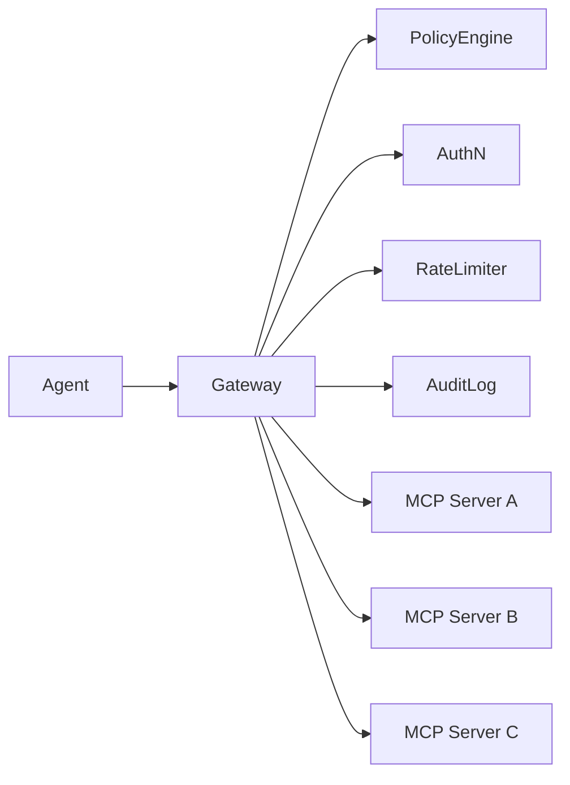

# EPP Market Positioning: The Open Source Governance Layer for AI Agents

> **Date:** June 5, 2026  
> **Context:** First Principles analysis of MCP Gateway market + EPP architecture fit  
> **Status:** Strategic insight — captured, not yet validated

---

## The Market Need (validated)

The market has independently discovered a gap:

| Evidence | Source |
|----------|--------|
| 5+ MCP Gateway vendors (Portkey, Cloudflare, TrueFoundry, TokenMix, Tyk) | Market |
| 150+ orgs adopting A2A — but still building governance on top | Google A2A ecosystem |
| "Authentication is mandatory for any protocol involving code execution" | IOActive, BHIS, Knostic |
| MCP Roadmap calls out audit trails as needed but not yet spec'd | MCP official roadmap |

**Translation:** The market is paying for something that MCP/A2A do not provide. They are paying for:
- Policy enforcement
- Audit/provenance
- Access control
- Cost management
- Threat protection

**They are paying for governance. And they are building it themselves, case by case, vendor by vendor.**

---

## The Current Solution (flawed)

The market's answer in 2026 is: **MCP Gateway**



But every gateway is:
- **Proprietary** (vendor lock-in)
- **SaaS** (per-call pricing)
- **A proxy** (extra hop, extra latency, extra failure point)
- **MCP-only** (doesn't work with A2A)
- **Different** (no standard — each vendor's policies are incompatible)

---

## The EPP Insight

EPP is not a gateway. EPP is an **architecture** that does what gateways do — but better.

### Architecture comparison

```
Gateway approach:           EPP approach:

Agent ──→ Gateway ──→ Tool  Agent ──→ Event Bus
                                    ↓
                              PDP (policy decision)
                                    ↓
                              PEP (policy enforcement)
                                    ↓
                              Provenance (audit)
                                    ↓
                              Execution (tool call)
```

### Key differences

| Aspect | Gateway | EPP |
|--------|---------|-----|
| **Architecture** | Proxy (network layer) | Event-native (architecture layer) |
| **Failure mode** | Single point of failure | Event Bus survives; subscribers are stateless |
| **Scalability** | Gateway must scale with traffic | Each subscriber scales independently |
| **Protocol support** | MCP only | MCP adapter, A2A adapter, any protocol |
| **Chain topology** | No (flat proxy) | Yes (subscriber chain) |
| **Vendor lock-in** | Yes (SaaS) | No (open source, self-hosted) |
| **Pricing** | Per-call ($$$) | Free core, paid enterprise features |
| **Standard** | No standard — each vendor unique | Potential open standard |

---

## The Positioning

### What EPP is NOT
- Not an MCP gateway (though it can replace one)
- Not an MCP server (though it can proxy as one)
- Not a competitor to MCP or A2A (complementary)

### What EPP IS
- **The open source governance layer for AI agents**
- A protocol-agnostic policy enforcement point
- An audit/provenance system by design
- A sandbox strategy framework
- **The missing layer between MCP (tool access) and A2A (agent collaboration)**

```
┌──────────────────────────────────────┐
│         APPLICATION LAYER             │
│  A2A (agent-to-agent collaboration)  │
├──────────────────────────────────────┤
│         GOVERNANCE LAYER ← EPP       │
│  Policy, Audit, Sandbox, Provenance │
├──────────────────────────────────────┤
│         INTEGRATION LAYER             │
│  MCP (agent-to-tool communication)  │
└──────────────────────────────────────┘
```

---

## Why Now

| Factor | Window |
|--------|--------|
| MCP is 18 months old — not yet ossified | ✅ Open |
| A2A is 14 months old — not yet ossified | ✅ Open |
| MCP Gateways exist but all proprietary | ✅ Open standard gap |
| No open source governance layer exists | ✅ Green field |
| Market is actively paying for governance | ✅ Demand validated |
| Enterprises are confused (MCP vs A2A vs Gateway) | ✅ Need for clarity |

**This window will not stay open.** Every month, another SaaS gateway gets funded. Every month, enterprises build more custom governance. After 12 more months, the space will be fragmented (like API gateways before it — Kong, Apigee, AWS, all proprietary, all different).

---

## The Product Evolution

```
Phase 1 (now):    EPP as MCP Governance Layer
                  └── works with existing MCP servers
                  └── replaces need for Portkey/Cloudflare/TrueFoundry
                  └── "Open source MCP governance"

Phase 2 (3-6mo):  EPP as Unified Governance
                  └── adds A2A support
                  └── governs both MCP calls and A2A delegations
                  └── "One governance layer for all your agents"

Phase 3 (6-12mo): EPP Protocol
                  └── capabilities() + invoke() — unified primitive
                  └── MCP adapter for legacy tools
                  └── A2A adapter for agent collaboration
                  └── "The standard protocol for AI agent governance"
```

---

## The Pitch (one sentence)

> **MCP connects agents to tools. A2A connects agents to agents. EPP governs what happens when they do.**

or:

> **MCP is the USB-C for AI. A2A is the TCP/IP for AI. EPP is the firewall for AI.**

or (more precise):

> **Every MCP Gateway is a proprietary answer to the same question. EPP is the open source answer.**
